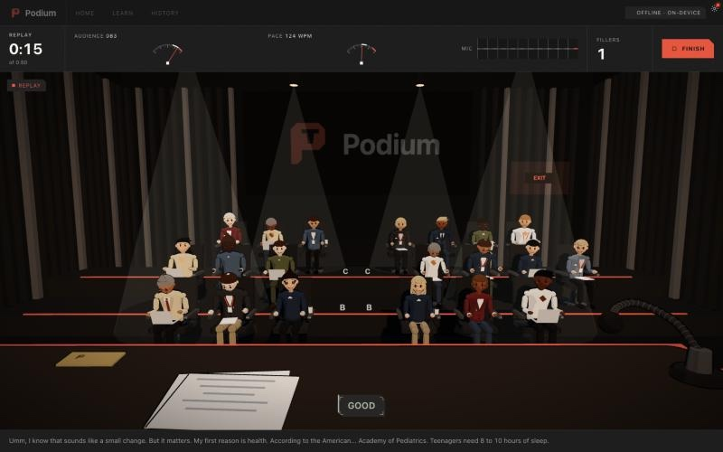
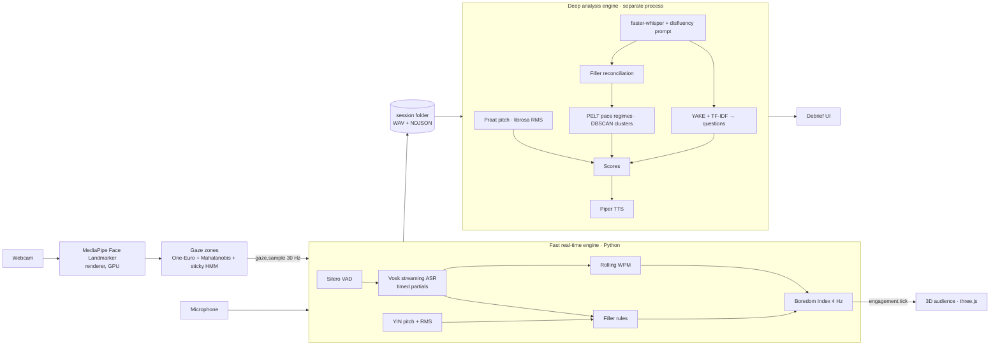

# Podium

**An offline public speaking coach with a virtual audience that reacts to you in real time.**

Podium listens to your pace, filler words and vocal variety, and watches where you look. A low-poly
audience leans in, takes notes, or pulls out their phones based on how you're doing. When you finish,
you get a full debrief: scores, a clickable timeline of key moments, an eye-contact heatmap, a spoken
summary, and follow-up questions generated from your own speech.

**Everything runs on your computer.** No cloud APIs, no accounts, no internet at runtime. The app
blocks outbound network requests in code, and a test checks it.



| Debrief | Timeline |
|---|---|
|  |  |

Built for the TSA Software Development event. The full design is in
[`docs/TECHNICAL_SPEC.md`](docs/TECHNICAL_SPEC.md).

## Features

| | |
|---|---|
| **Live pacing** | Words per minute over rolling 5 s windows, color-banded (drag / slow / optimal / fast / rushing) |
| **Filler detection** | *um, uh, like, you know, so, basically…* from a hybrid of speech recognition, context rules and acoustics |
| **Boredom Index** | Fuses filler density, pitch/loudness monotony, gaze and pace into one 0–100 engagement score; audiences lose interest faster than they regain it |
| **Eye-contact zones** | MediaPipe face mesh + iris tracking → Left / Center / Right audience / Notes, with a 12-second room calibration |
| **Reactive audience** | 9–18 avatars, each with its own personality. A seating section you ignore drifts toward boredom; look at it and it perks up |
| **Deep debrief** | Whisper transcript, pitch analysis via Praat, pace change-points (PELT), filler clusters (DBSCAN), structure checks, composite score |
| **Spoken feedback** | Piper TTS reads the debrief and the follow-up questions aloud |
| **Q&A round** | Right after the speech: 5 questions about what you just said (ready in about 2 s), read aloud. Pick one or two and answer on the spot under a timer. Built from keyphrases (YAKE + TF-IDF against 60 public-domain speeches) and rule templates, with no LLM |
| **Replay Mode** | Plays a recorded session back through the live pipeline. It's a demo-day safety net if a mic or camera fails |
| **History** | Every run is saved locally (NDJSON telemetry + SQLite index), with a progress trend |

## Architecture



- **`apps/desktop/`**: Electron + React + TypeScript. Camera, face tracking, 3D audience, HUD, debrief.
- **`engine/`**: Python 3.11. Real-time engine, deep-analysis engine, NLP, TTS, storage, WebSocket server.
- **`docs/`**: technical spec, architecture decision records, evaluation.

## Getting started

Requirements: macOS / Windows / Linux, Python via [uv](https://docs.astral.sh/uv/), Node.js 22+, a
webcam and a microphone. On Linux you also need `libportaudio2`.

```bash
make setup     # Python + Node deps, downloads ~300 MB of models once (the only time Podium uses the network)
make dev       # launches the desktop app
```

Without `make`:

```bash
cd engine && uv sync --python 3.11 && uv run python ../scripts/fetch_models.py
cd ../apps/desktop && npm install && npm run dev
```

macOS will ask for camera and microphone permission on first launch.

### Browser dev mode (no Electron)

```bash
make engine    # engine on ws://127.0.0.1:8765, token "dev"
make web       # open http://127.0.0.1:5173
```

### Headless replay of any recording

```bash
cd engine && uv run python -m podium_engine replay path/to/speech.wav
```

## Tests and measurements

```bash
make test      # 41 Python tests (incl. end-to-end replay → analysis) + 15 TypeScript tests
make bench     # real-time factor, filler latency, analysis time on this machine
make smoke     # builds the app, launches it hidden, checks it connects to the engine
```

Measured on an Apple M1 (CPU only): the live engine runs **12.6× faster than real time**, and deep
analysis takes **0.29 s per second of speech**. Details and limitations are in
[`docs/evaluation/`](docs/evaluation/README.md).

## Privacy

Recordings, transcripts and telemetry stay in your OS app-data folder (`~/Library/Application
Support/Podium` on macOS, `%APPDATA%\Podium` on Windows). Delete any session from the History screen.
The Electron main process cancels every non-local request, the renderer's Content-Security-Policy only
allows loopback connections, and the Python engine replaces `socket.connect` with a guard that rejects
non-loopback hosts.

## Known limitations

- Live filler alerts arrive about **1.6 s** after the filler (Vosk partial-result lag); the deep
  analysis is more accurate.
- Accuracy numbers so far come from a synthetic fixture. A labelled set of real recordings is the next
  step (`scripts/evaluate_fillers.py`).
- English only. One speaker.
- The installer packaging (PyInstaller + electron-builder) is not set up yet. Run from source for now.

## License

MIT for Podium's code. Models and some libraries have their own licenses; see
[`THIRD_PARTY_NOTICES.md`](THIRD_PARTY_NOTICES.md) (Piper TTS and Parselmouth are GPL-3.0).
