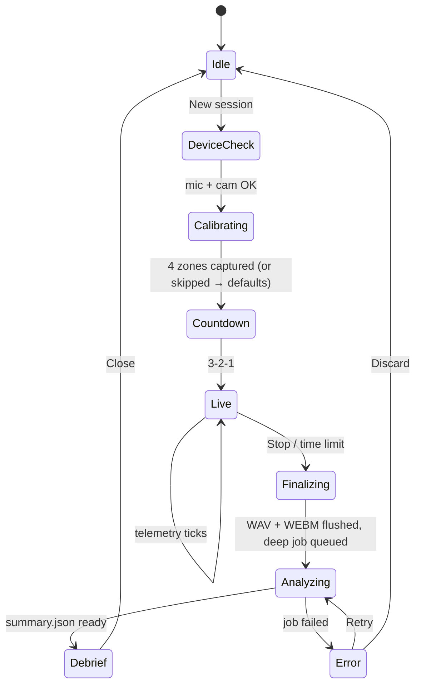
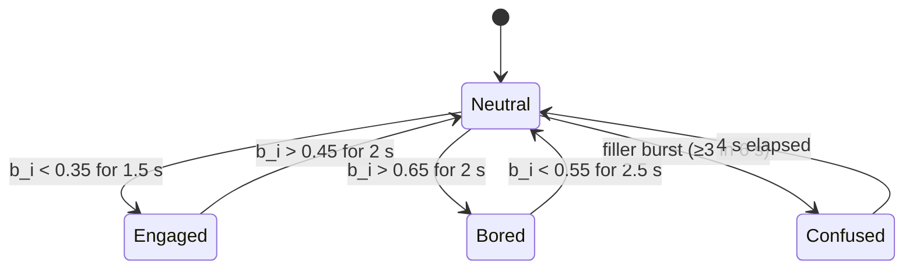

# Podium — Technical Software Specification

**An offline, real-time public speaking analysis and simulation platform**

| | |
|---|---|
| Document | Technical Software Specification v1.0 |
| Status | Draft for implementation |
| Target event | TSA Software Development |
| Runtime constraint | 100% offline, all inference local (CPU baseline, GPU optional) |
| Reference hardware | 4-core x86-64 or Apple Silicon laptop, 8 GB RAM, 720p webcam, built-in mic, no discrete GPU |

> "Podium" is a working name. Replace it everywhere if your team picks another.

> **Implementation status (v0.1).** The repo implements this spec end to end. Where the build differs
> from the original plan, the reason is recorded in `docs/adr/`:
> - Vosk's small model cannot emit "um"/"uh", so live filled pauses use a *sound-alike* rule on timed
>   partial results plus an acoustic detector (ADR 0003). Measured live alert latency is about 1.6 s,
>   not the 0.6 s target.
> - Deep pitch tracking uses Praat (Parselmouth) instead of `librosa.pyin`: pYIN took 7.4 s on 30 s of
>   audio, Praat takes 0.03 s. Librosa still provides RMS energy.
> - Face tracking runs on the renderer main thread (GPU delegate), not a Web Worker (ADR 0002).
> - IPC uses JSON, not MessagePack, and the engine timestamps gaze samples on arrival instead of
>   running clock sync (ADR 0004).
> - The SQLite session index lives in the Python engine (stdlib `sqlite3`) rather than `better-sqlite3`
>   in Electron, which avoids a native Node module rebuild.
> - Measured numbers are in `docs/evaluation/README.md`.

---

## Table of Contents

1. [Goals, Non-Goals, and Constraints](#1-goals-non-goals-and-constraints)
2. [System Architecture](#2-system-architecture)
3. [Tech Stack](#3-tech-stack)
4. [Module Specifications](#4-module-specifications)
5. [Data Schema and State Management](#5-data-schema-and-state-management)
6. [Algorithms and Math](#6-algorithms-and-math)
7. [Performance Budgets and Degradation](#7-performance-budgets-and-degradation)
8. [Testing and Validation](#8-testing-and-validation)
9. [Risk Register](#9-risk-register)
10. [TSA Competition Strategy](#10-tsa-competition-strategy)
11. [Appendix: Default Constants](#appendix-a-default-constants)

---

## 1. Goals, Non-Goals, and Constraints

### 1.1 Goals

| ID | Goal | Measurable target |
|---|---|---|
| G1 | Live feedback while speaking | Filler alert shown ≤ 600 ms after the filler ends; WPM refresh at 1 Hz; gaze zone refresh ≥ 15 Hz |
| G2 | Audience reacts believably | Avatar state changes at most once every 2 s per avatar (no flicker), and the trend tracks the Boredom Index |
| G3 | Deep debrief | Full report for a 5-minute speech in ≤ 60 s on reference hardware |
| G4 | Spoken debrief and Q&A | TTS starts ≤ 3 s after the report is ready; 5–8 follow-up questions generated |
| G5 | Provably offline | No outbound network traffic at runtime, enforced in code and checked by an automated test |

### 1.2 Non-Goals (v1)

- Multi-speaker diarization (assume one speaker).
- Non-English speech (the architecture allows swapping models later).
- Cloud sync, accounts, or LLM-generated feedback.

### 1.3 Hard Constraints

1. **No network at runtime.** Every model, wordlist, IDF table, voice, and font ships inside the installer. The app blocks all non-local requests (§3.5).
2. **Real-time and deep analysis are separated.** The real-time engine never waits on the deep engine. They run in separate OS processes.
3. **Privacy by default.** Raw audio and video stay in the user's local app-data folder. Users can delete any session.

---

## 2. System Architecture

### 2.1 Process Topology

The app runs as three cooperating local processes:

| Process | Technology | Owns |
|---|---|---|
| **Shell / UI** | Electron (Chromium renderer + Node main) | Window, camera capture, **gaze inference (MediaPipe in a Web Worker)**, 3D audience, dashboards, video recording |
| **Real-Time Engine** | Python 3.11 sidecar (asyncio) | Microphone capture, VAD, streaming ASR, fillers, WPM, real-time prosody, **Boredom Index fusion** |
| **Deep Analysis Engine** | Python worker process (spawned on demand) | Accurate transcription, Librosa/Praat prosody, segmentation, clustering, scoring, keyphrases, Q&A, TTS synthesis |

**Why gaze runs in the renderer:** the renderer already holds the camera stream for the preview and recording. Running MediaPipe Tasks Vision (WASM + WebGL) in a Web Worker means video frames never cross the process boundary. Only small gaze vectors (about 100 bytes at 30 Hz) go to the Python engine. It also avoids the problem on Windows where only one process can open the webcam.

**Transport:** WebSocket on `127.0.0.1:<random port>`. The Electron main process spawns the sidecar with a random port and a one-time auth token. Messages are MessagePack-encoded envelopes (§5.5). This is loopback only and never leaves the machine.

### 2.2 System Architecture Diagram

```mermaid
flowchart LR
    subgraph INPUT["Capture Layer"]
        MIC["🎤 Microphone<br/>16 kHz mono PCM<br/>(sounddevice)"]
        CAM["📷 Webcam<br/>720p @ 30 fps<br/>(getUserMedia)"]
    end

    subgraph RENDERER["Electron Renderer"]
        direction TB
        GW["Gaze Worker<br/>MediaPipe Face Landmarker<br/>478 landmarks + iris + pose matrix"]
        GZ["Gaze Zone Classifier<br/>One-Euro filter → Mahalanobis<br/>→ sticky HMM"]
        REC["MediaRecorder<br/>session.webm"]
        AUD["3D Audience<br/>react-three-fiber<br/>avatar FSMs"]
        DASH["Live HUD<br/>WPM · fillers · engagement"]
        DEB["Debrief UI<br/>heatmap · timeline · Q&A"]
    end

    subgraph FAST["⚡ Fast Real-Time Engine (Python sidecar)"]
        direction TB
        RB[("Lock-free ring buffer<br/>30 s audio")]
        VAD["Silero VAD (ONNX)<br/>30 ms frames"]
        ASR["Vosk streaming ASR<br/>partial + final words"]
        FPD["Acoustic filled-pause<br/>detector (um/uh)"]
        LEX["Lexical filler matcher<br/>like · you know · so"]
        PRO["RT prosody<br/>YIN f0 · RMS dB"]
        PACE["Pacing<br/>5 s rolling WPM"]
        BI["Boredom Index Fusion<br/>4 Hz leaky integrator"]
        WAV[("session.wav<br/>writer")]
    end

    subgraph DEEP["🔬 Deep Analysis Engine (worker process)"]
        direction TB
        WH["faster-whisper base.en<br/>int8 + word timestamps<br/>+ disfluency prompt"]
        MRG["Filler reconciliation<br/>(Whisper ∪ FPD ∪ Vosk)"]
        LIB["Librosa pYIN f0 · RMS<br/>Parselmouth jitter/shimmer"]
        SEG["Segmentation<br/>PELT pace regimes ·<br/>DBSCAN filler clusters"]
        NLP["NLP<br/>YAKE + TF-IDF keyphrases ·<br/>NLTK POS/chunking"]
        QA["Rule-based<br/>Q&A generator"]
        SC["Scoring + debrief script"]
        TTS["Piper TTS (ONNX)<br/>debrief.wav"]
    end

    STORE[("Session Store<br/>%APPDATA%/Podium/sessions/<id>/<br/>NDJSON telemetry + SQLite index")]

    CAM --> GW --> GZ
    CAM --> REC
    GZ -- "gaze.sample @30 Hz (WS)" --> BI
    GZ --> DASH

    MIC --> RB
    RB --> VAD --> ASR --> LEX
    VAD --> FPD
    RB --> PRO
    RB --> WAV
    ASR --> PACE
    LEX --> BI
    FPD --> BI
    PRO --> BI
    PACE --> BI
    BI -- "engagement.tick @4 Hz (WS)" --> AUD
    BI --> DASH

    WAV --> STORE
    REC --> STORE
    BI -- "telemetry NDJSON" --> STORE

    STORE == "session.stop → job" ==> WH
    WH --> MRG
    STORE --> LIB
    MRG --> SEG
    LIB --> SEG
    MRG --> NLP --> QA
    SEG --> SC
    QA --> SC
    SC --> TTS
    SC -- "summary.json" --> STORE
    STORE --> DEB
    TTS --> DEB
```



### 2.3 Session Lifecycle



### 2.4 Concurrency Model (Real-Time Engine)

```
sounddevice callback (PortAudio thread, 20 ms blocks)
   └─► RingBuffer.write()                       # no allocation, no GIL-heavy work
asyncio loop (main thread)
   ├─ task: vad_loop        30 ms hop  → speech segments
   ├─ task: asr_loop        Vosk AcceptWaveform (C code, releases GIL)
   ├─ task: prosody_loop    40 ms hop  → f0, RMS
   ├─ task: fusion_loop     250 ms tick → Boredom Index, emits engagement.tick
   ├─ task: ws_server       recv gaze.sample, send events
   └─ task: telemetry_sink  batched NDJSON append every 1 s
```

The deep engine is a separate `multiprocessing` process with `spawn` start method, so a crash or heavy Whisper run can never stall the live UI. It starts at lower OS priority (`os.nice(10)` / `BELOW_NORMAL_PRIORITY_CLASS`).

---

## 3. Tech Stack

### 3.1 Selection

| Layer | Choice | Why | Fallback |
|---|---|---|---|
| Desktop shell | **Electron 3x** + Vite | Same Chromium on Win/macOS/Linux, so getUserMedia, WASM SIMD, WebGL2, and MediaRecorder all behave the same. Mature sidecar spawning. | Tauri 2 (smaller binary, but WebKit on macOS differs for camera/WASM) |
| UI framework | **React 18 + TypeScript (strict)** | Typed, testable, large ecosystem | — |
| UI state | **Zustand** (+ a hand-written FSM for the session lifecycle) | Small; selector-based re-renders; works outside React for 30 Hz data | XState |
| 3D audience | **three.js via react-three-fiber + drei** | Declarative scene, instancing, AnimationMixer crossfades | Plain Canvas 2D sprites |
| Charts / heatmap | **visx** (D3 primitives) or **uPlot** for dense time series | Fast, SVG/Canvas, no network | ECharts |
| Gaze / face | **@mediapipe/tasks-vision** FaceLandmarker (`face_landmarker.task`), WASM files bundled | 478 landmarks incl. iris; outputs a facial transformation matrix (head pose) directly; GPU delegate via WebGL | Python `mediapipe` in the sidecar |
| Back-end runtime | **Python 3.11**, packaged with **PyInstaller** (one-dir) | Best local ML/audio ecosystem | Nuitka |
| IPC | **websockets** + **msgpack** | Async, binary, simple | ZeroMQ |
| Schemas | **JSON Schema** as source of truth → **pydantic v2** models + TS types (`json-schema-to-typescript`) | One contract, two languages, checked in CI | — |
| Audio I/O | **sounddevice** (PortAudio), **soundfile** | Low-latency callback capture | PyAudio |
| VAD | **Silero VAD** (ONNX, ~2 MB) via **onnxruntime** | Accurate, ~1 ms per 30 ms frame on CPU | `webrtcvad` |
| Streaming ASR | **Vosk** `vosk-model-small-en-us-0.15` (~40 MB) | True streaming, partial results in ~200 ms, CPU-light | `whisper.cpp` stream mode |
| Accurate ASR | **faster-whisper** (CTranslate2) `base.en` int8; `small.en` optional | Word timestamps; ~4–8× real-time on CPU | `whisper.cpp` |
| RT pitch | **YIN** (`aubio` `yinfast`, or 60-line NumPy YIN) | < 1 ms per 40 ms frame | — |
| Deep prosody | **librosa** (`pyin`, `rms`, `onset`), **praat-parselmouth** (jitter, shimmer, HNR, formants) | Research-grade and well documented | — |
| Segmentation | **ruptures** (PELT change-points), **scikit-learn** (DBSCAN) | Standard, explainable | — |
| NLP | **NLTK** (punkt, POS tagger, stopwords bundled as data), **YAKE**, **scikit-learn** `TfidfVectorizer` | Rule-based and explainable; no LLMs | spaCy `en_core_web_sm` |
| TTS | **Piper** (ONNX voice, e.g. `en_US-lessac-medium`, ~60 MB) | Natural voice, faster than real-time on CPU | Web Speech API restricted to `voice.localService === true` |
| Storage | NDJSON telemetry files + **SQLite** (`better-sqlite3`) session index | Append-only (crash-safe), easy to inspect, queryable history | — |
| Testing | **pytest**, **hypothesis**, **Vitest**, **Playwright** (Electron) | Unit + property + end-to-end | — |
| Lint / format | ruff, mypy --strict, ESLint, Prettier | Shows engineering discipline | — |

### 3.2 Bundled Model Manifest

All models are fetched once at **build time** by `scripts/fetch_models.py`, verified with SHA-256, and packaged into the installer. **Nothing is downloaded at runtime.**

| Asset | Size (approx.) | License (verify before shipping) |
|---|---|---|
| `face_landmarker.task` | 3.7 MB | Apache-2.0 |
| MediaPipe WASM runtime | 10 MB | Apache-2.0 |
| `silero_vad.onnx` | 2 MB | MIT |
| `vosk-model-small-en-us-0.15` | 40 MB | Apache-2.0 |
| faster-whisper `base.en` (CT2 int8) | 75–145 MB | MIT |
| Piper voice `en_US-lessac-medium.onnx` | 63 MB | Check the voice's `MODEL_CARD`. Newer Piper releases (`piper1-gpl`) are GPL-3.0. |
| NLTK data (punkt, averaged_perceptron_tagger, stopwords) | 15 MB | Apache-2.0 / various |
| `idf_reference.json` (precomputed from a public-domain speech corpus) | 2 MB | Your own derived data |

Total installer size is about 350–450 MB. Record every license in `THIRD_PARTY_NOTICES.md`. Judges check this.

### 3.3 Offline Enforcement (Defense in Depth)

1. **Electron:** `session.defaultSession.webRequest.onBeforeRequest` cancels any URL whose scheme isn't `file:`, `app:`, `devtools:`, or `ws://127.0.0.1`. A strict CSP is set: `default-src 'self'; connect-src 'self' ws://127.0.0.1:*`.
2. **Python:** set `HF_HUB_OFFLINE=1` and `TRANSFORMERS_OFFLINE=1`. Load every model from an absolute bundled path. In tests, `pytest-socket` (`--disable-socket --allow-hosts=127.0.0.1`) fails any test that opens an external socket.
3. **Web Speech fallback:** only voices with `localService === true` are allowed, because Chrome's "Google" voices call the network.
4. **CI check:** an end-to-end test runs a full session with the network namespace disabled (Linux `unshare -n`) and asserts the run succeeds.

---

## 4. Module Specifications

### 4.1 Fast Real-Time Engine

#### 4.1.1 Audio Capture
- 16 kHz, mono, float32, 20 ms blocks (320 samples).
- The PortAudio callback only copies into a pre-allocated `RingBuffer(capacity = 30 s)`. No logging, allocation, or locks happen in the callback.
- A parallel writer streams int16 PCM to `audio.wav` through `soundfile` in 1 s chunks.

#### 4.1.2 Voice Activity Detection
- Silero VAD on 30 ms frames. Speech starts when $p > 0.5$ for ≥ 90 ms and ends when $p < 0.35$ for ≥ 250 ms (hysteresis).
- Outputs `SpeechSegment(t_start, t_end)` and a **pause stream**: every gap ≥ 250 ms is a pause event. Pause duration feeds the pacing and debrief logic.

#### 4.1.3 Filler Word Detection (real time)

Use a **hybrid detector**. Streaming ASR models trained on read speech often drop "um" and "uh", so ASR alone is not enough.

| Filler class | Examples | Detector |
|---|---|---|
| **Filled pauses** | um, uh, er, ah, hmm | **Acoustic Filled-Pause Detector (FPD)** plus any Vosk tokens `uh`, `um`, `[unk]` inside a voiced, low-articulation segment |
| **Lexical fillers** | like, you know, so, basically, actually, literally, right, I mean, kind of, sort of | **Regex/token matcher** on Vosk final words, with context rules |

**Acoustic FPD.** Candidate = a voiced segment from 150 to 1200 ms with:
- f0 stability: $\sigma_{st} < 0.8$ semitones across the segment (people hold a flat pitch when saying "uhhh");
- spectral stability: mean spectral flux below the 30th percentile of that speaker's running distribution;
- low articulation: no Vosk word boundary inside the segment, or the word is `uh`/`um`/`[unk]`.

These features feed a logistic regression with 8 features. Train it on your team's own labeled clips (§8.2) and ship the weights as JSON. **Stretch goal:** a small log-mel CNN trained offline on the public *PodcastFillers* dataset, exported to ONNX (~1 MB).

**Lexical context rules** (cut false positives for "like" and "so"):

```
like  → FILLER   if (preceded by pause ≥150 ms OR sentence-initial OR followed by pause)
                  AND previous token ∉ {would, feel, feels, look, looks, sound, sounds,
                                         seem, seems, i, you, we, they, he, she, just}
                  AND next token ∉ {a, an, the, this, that, to}  # "like a…", "like to…"
so    → FILLER   only if utterance-initial AND followed by pause ≥ 200 ms
you know → FILLER unless followed by "that|what|how|why|the"
right → FILLER   only if utterance-final AND rising f0 (tag question)
```

The real-time stage accepts lower precision in exchange for speed. The deep engine re-checks each candidate with POS tags (§4.2.2).

**Event emitted:** `filler.detected { t, token, class, confidence, source }`. The HUD flashes the token, and the event goes into the Boredom fusion.

#### 4.1.4 Pacing (WPM)
- Word timestamps come from Vosk final results (`SetWords(True)`).
- Rolling window $W = 5$ s with 1 s hop (formulas in §6.3).
- Show two rates: **speaking rate** (includes pauses; what the audience perceives) and **articulation rate** (excludes pauses; how fast the mouth moves).
- HUD bands: **< 110 Drag**, **110–130 Slow**, **130–170 Optimal**, **170–190 Fast**, **> 190 Rushing**.

#### 4.1.5 Real-Time Prosody
- YIN f0 on 40 ms frames with 10 ms hop, range 65–400 Hz, only on VAD-voiced frames.
- Convert to semitones relative to the **speaker baseline** $f_{ref}$, which is the median f0 from the first 20 s of voiced speech, or the calibration read if you add one.
- RMS energy in dBFS over the same frames.
- Rolling 10 s statistics: $\sigma_{st}$ (pitch variability) and the coefficient of variation of RMS. Both feed the Monotony component.

#### 4.1.6 Boredom Index Fusion
Runs every 250 ms. It consumes the latest filler, prosody, pacing, and gaze aggregates and emits:

```json
{ "type": "engagement.tick", "t": 73.25, "B": 0.41, "E": 59,
  "components": { "filler": 0.22, "monotony": 0.55, "gaze": 0.38, "pace": 0.10 },
  "zoneShare": { "L": 0.21, "C": 0.48, "R": 0.09, "N": 0.22 },
  "audienceState": "neutral" }
```

The full math is in §6.1.

### 4.2 Deep Analysis Engine

Triggered by `session.stop`. It reads `audio.wav` and the telemetry NDJSON files, then writes `summary.json`, `transcript.json`, `questions.json`, and `debrief.wav`. Progress is reported over WS (`analysis.progress {stage, pct}`).

| Stage | Input | Process | Output |
|---|---|---|---|
| 1. Transcribe | audio.wav | faster-whisper `base.en`, `word_timestamps=True`, `vad_filter=True`, **`initial_prompt="Umm, so, uh, I was like, you know, thinking… Hmm, okay."`**. This disfluent prompt pushes Whisper to transcribe fillers instead of cleaning them out. | words[] with t0, t1, p |
| 2. Filler reconciliation | Whisper words, RT filler events | Union the three sources. Two events within 300 ms are the same filler. Final confidence = max of source confidences. | fillers[] (authoritative) |
| 3. Lexical disambiguation | transcript | NLTK POS tagging. Grammatical "like" (tagged `IN` or `VB*` with a valid object) is not a filler. | fillers[] refined |
| 4. Prosody | audio.wav | `librosa.pyin` (fmin 65, fmax 400, frame 2048 @ 16 kHz, hop 160), `librosa.feature.rms`; Parselmouth jitter, shimmer, HNR | f0 track, RMS track, per-sentence prosody |
| 5. Pace segmentation | words[] | WPM series → Savitzky–Golay smoothing → PELT change-points → regime labels | paceSegments[] |
| 6. Filler clustering | fillers[] | 1-D DBSCAN (eps 4 s, min_samples 3) and burstiness coefficient | fillerClusters[] |
| 7. Structure | transcript | Sentence split; detect the opening (first 15%), body, and conclusion (last 10%); detect transition markers ("first", "next", "finally", "in conclusion") | structure{} |
| 8. Keyphrases | transcript | YAKE (n ≤ 3) ∪ TF-IDF against the bundled reference IDF; NP chunking | keyphrases[] |
| 9. Q&A | keyphrases, sentences | Rule templates + MMR ranking (§4.4.2) | questions[] |
| 10. Scoring | everything | Sub-scores → composite (§6.5) | scores{} |
| 11. Debrief script + TTS | scores, highlights | Template script → Piper | debrief.txt, debrief.wav |

**Performance target:** a 5-minute speech finishes in ≤ 60 s on reference hardware. Whisper `base.en` int8 takes about 30–45 s. Every other stage takes under 10 s combined.

### 4.3 Computer Vision and Gaze Module

#### 4.3.1 Pipeline (Web Worker)
1. `requestVideoFrameCallback` → `ImageBitmap` transferred to the worker (zero-copy).
2. `FaceLandmarker.detectForVideo()` with `outputFacialTransformationMatrixes: true`, `numFaces: 1`, GPU delegate.
3. Extract head pose (yaw $\psi$, pitch $\phi$, roll) from the 4×4 matrix and iris displacement from the iris and eye-corner landmarks (§6.2).
4. One-Euro filter on the angles, then the zone classifier, then sticky HMM smoothing.
5. Post `gaze.sample` to the main thread, which forwards it to the engine at 30 Hz and also feeds the live mini-map.

**Mirroring:** the camera faces the speaker, so the **speaker's left appears on the image's right**. Negate yaw once, at the source. Write a unit test for this.

#### 4.3.2 Zones
| Code | Zone | Meaning |
|---|---|---|
| `L` | Left Audience | Speaker looks to their left |
| `C` | Center Audience | Straight ahead, above the notes |
| `R` | Right Audience | Speaker looks to their right |
| `N` | Speaker Notes / Slides | Looking down at the laptop or notes |
| `X` | Away / No face | Outside every zone, or no face detected |

#### 4.3.3 Calibration (≈ 12 s, skippable)
The UI shows four targets one at a time (left, center, right, notes). The user looks at each for 2.5 s while the app collects about 60 samples per zone. It then fits a per-zone Gaussian $\mathcal{N}(\mu_z, \Sigma_z)$ in (yaw, pitch) space. If calibration is skipped, the app uses the default angular thresholds (§6.2.3). Calibration makes the system work for any room layout, which is worth pointing out to judges.

#### 4.3.4 Heatmap Output
- **Continuous heatmap:** a 2-D histogram of (yaw, pitch) in 2° bins, smoothed with a Gaussian kernel (σ = 1.5 bins) and drawn under the zone boundaries.
- **Zone bars:** percentage of face-visible time in each zone.
- **Timeline ribbon:** zone colour over time, aligned with the transcript and WPM chart. Clicking a point seeks the recorded video.

### 4.4 Interactive Audience (Dynamic Visual Feedback)

#### 4.4.1 Scene
- A classroom/auditorium with 12–18 low-poly avatars in three seating sections that match the gaze zones L, C, and R.
- Avatars are built from primitives (capsule body, sphere head, box limbs) with flat shading. This avoids an art pipeline, keeps the look consistent, and allows `InstancedMesh` for bodies. Props: notebook, phone (with an emissive screen), coffee cup.
- Procedural animation drives bones/joints with spring-damped targets, so no mocap clips are needed. Every avatar gets a seeded noise phase so they never move in sync.

#### 4.4.2 Avatar Finite-State Machine



| State | Behaviours (randomly picked, weighted) |
|---|---|
| **Engaged** | Lean forward 15°, write notes, nod (triggered on speaker pitch peaks), head tracks the speaker |
| **Neutral** | Upright, blink, small posture shifts |
| **Bored** | Slump, take out phone (screen glows), look sideways, yawn, rest chin on hand |
| **Confused** | Head tilt, furrowed brow (texture swap), glance at a neighbour |

Each avatar $i$ computes its **own** boredom $b_i$ from the global index, its personality offset, and whether the speaker has been looking at its section (§6.1.4). Looking at the left section makes the left avatars perk up, which is a strong, intuitive moment for a demo.

**Render budget:** 60 fps at 1080p on integrated graphics. Frame budget ≤ 4 ms. Shadows are baked; there is one directional light.

### 4.5 Post-Speech Debrief and Q&A

#### 4.5.1 Debrief Script (template-based)
Structure: **strength → 2 growth areas → 1 concrete drill → encouragement**. Example templates:

```
OPEN_STRONG_GAZE  : "Nice work. You spent {pct_audience}% of your time looking at the audience, which is above the {target}% target."
GROW_FILLER_BURST : "At {mm:ss}, you used {n} filler words in {window} seconds, right as you moved into {topic}. Try pausing silently there instead."
GROW_RUSH         : "Your pace climbed to {wpm} words per minute between {t0} and {t1}. That section was {pct}% faster than your average."
GROW_MONOTONE     : "Your pitch varied by only {st} semitones in the {section}. Try stressing one key word in each sentence."
DRILL_PAUSE       : "Drill: read your opening aloud and replace every 'um' with a one-second pause."
```

Selection: each template has a trigger predicate and a priority score (severity × how much it would help to fix). Pick the top 2 growth items. Never repeat the same metric.

#### 4.5.2 Follow-Up Question Generator (no LLM)

1. **Candidate terms:** YAKE keyphrases (lower is better, inverted) merged with TF-IDF terms scored against the bundled reference IDF. Keep noun phrases from the NLTK regex chunker: `NP: {<JJ.*>*<NN.*>+}`.
2. **Sentence typing:** classify each sentence that contains a term with rules:

| Sentence type | Detection rule | Question template |
|---|---|---|
| Claim | modal or evaluative verb: *should, must, will, best, always, never* | "What evidence supports your claim that {claim_np}?" |
| Statistic | `CD` token or a % sign | "Where does the figure '{number} {unit}' come from, and how recent is it?" |
| Causal | *because, leads to, causes, results in, therefore* | "Could anything other than {cause_np} explain {effect_np}?" |
| Comparison | `JJR`/`RBR`, *than, versus, compared* | "How does {np_a} compare with {np_b} in terms of cost or trade-offs?" |
| Proposal | *we propose, my solution, I recommend* | "What is the biggest risk in implementing {np}, and how would you reduce it?" |
| Under-explained | Keyphrase appears once, in < 5 s of speech | "You briefly mentioned {np}. Can you expand on that?" |
| Definition gap | Uncommon term (high IDF) never followed by *is, means, refers to* | "How would you explain {np} to someone new to the topic?" |

3. **Ranking:** $\text{score}(q) = w_k \cdot \text{keyphrase}(q) + w_t \cdot \text{templatePrior}(q)$. Use **Maximal Marginal Relevance** with λ = 0.7 (cosine similarity over TF-IDF vectors) to pick 5–8 diverse questions.
4. **Practice mode:** Piper reads each question aloud. The user answers with a 60 s timer, and the answer is analysed by the same real-time engine as a mini-session.

---

## 5. Data Schema and State Management

### 5.1 On-Disk Layout

```
<userData>/Podium/
├── podium.db                         # SQLite index: sessions, scores (fast history queries)
└── sessions/
    └── 2026-10-14T17-30-02Z_7f3a/
        ├── session.json              # metadata + config snapshot
        ├── calibration.json
        ├── audio.wav                 # 16 kHz mono PCM16
        ├── video.webm                # optional, user toggle
        ├── telemetry/
        │   ├── words.ndjson          # RT ASR words
        │   ├── fillers.ndjson
        │   ├── pace.ndjson           # 1 Hz
        │   ├── prosody.ndjson        # 10 Hz decimated
        │   ├── gaze.ndjson           # 30 Hz
        │   └── engagement.ndjson     # 4 Hz
        ├── transcript.json           # deep engine
        ├── summary.json              # deep engine (final metrics)
        ├── questions.json
        ├── debrief.txt
        └── debrief.wav
```

**Why NDJSON:** it is append-only, so a crash loses at most 1 s of data. It streams easily, judges can read it in any text editor, and it loads straight into pandas (`pd.read_json(..., lines=True)`). All timestamps are **seconds since session start** (`float`, ms precision), measured on one clock (§5.4).

### 5.2 `session.json`

```json
{
  "$schema": "https://podium.local/schemas/session.v1.json",
  "schemaVersion": "1.0.0",
  "sessionId": "2026-10-14T17-30-02Z_7f3a",
  "createdAt": "2026-10-14T17:30:02.118Z",
  "title": "Mock TSA presentation – Run 3",
  "mode": "practice",
  "durationSec": 298.42,
  "status": "analyzed",
  "devices": {
    "audioInput": { "name": "MacBook Pro Microphone", "sampleRate": 16000 },
    "videoInput": { "name": "FaceTime HD Camera", "width": 1280, "height": 720, "fps": 30 }
  },
  "config": {
    "targetWpm": [130, 170],
    "fillerLexicon": ["um", "uh", "er", "ah", "like", "you know", "so", "basically", "actually", "literally", "i mean", "kind of", "sort of", "right"],
    "boredomWeights": { "filler": 0.25, "monotony": 0.30, "gaze": 0.35, "pace": 0.10 },
    "audienceSize": 15,
    "recordVideo": true
  },
  "app": { "version": "1.0.0", "engineVersion": "1.0.0", "models": {
    "rtAsr": "vosk-model-small-en-us-0.15", "deepAsr": "faster-whisper/base.en-int8",
    "face": "face_landmarker.task@float16/1", "tts": "piper/en_US-lessac-medium" } }
}
```

### 5.3 Telemetry Records (one JSON object per line)

```jsonc
// words.ndjson
{"t0": 12.31, "t1": 12.58, "w": "today", "p": 0.94, "src": "vosk"}

// fillers.ndjson
{"t0": 14.02, "t1": 14.61, "token": "um", "class": "filled_pause", "conf": 0.82, "src": "fpd"}
{"t0": 31.40, "t1": 31.62, "token": "like", "class": "lexical", "conf": 0.66, "src": "lex"}

// pace.ndjson  (1 Hz, 5 s window)
{"t": 30.0, "wpm": 162.0, "artRate": 188.4, "speechFrac": 0.86, "wordsInWin": 13.5}

// prosody.ndjson  (10 Hz decimated)
{"t": 30.1, "f0": 182.3, "st": 1.84, "rmsDb": -21.7, "voiced": true}

// gaze.ndjson  (30 Hz)
{"t": 30.133, "face": true, "yaw": -18.4, "pitch": 2.1, "roll": -1.0,
 "irisX": -0.21, "irisY": 0.05, "gYaw": -24.7, "gPitch": 3.6,
 "zone": "L", "zoneP": {"L": 0.91, "C": 0.08, "R": 0.0, "N": 0.01}, "conf": 0.97}

// engagement.ndjson  (4 Hz)
{"t": 30.25, "Braw": 0.44, "B": 0.39, "E": 61,
 "c": {"filler": 0.20, "monotony": 0.48, "gaze": 0.41, "pace": 0.12},
 "audience": {"engaged": 5, "neutral": 7, "bored": 3, "confused": 0}}
```

### 5.4 `summary.json` (Final Performance Metrics)

```json
{
  "schemaVersion": "1.0.0",
  "sessionId": "2026-10-14T17-30-02Z_7f3a",
  "durationSec": 298.42,
  "speakingTimeSec": 241.9,
  "scores": {
    "overall": 78,
    "pacing": 82, "fillers": 64, "vocalVariety": 75, "eyeContact": 85, "structure": 80,
    "grade": "B+"
  },
  "pacing": {
    "meanWpm": 151.3, "medianWpm": 149.0, "stdWpm": 21.4, "cv": 0.141,
    "npvi": 11.8, "articulationRate": 179.2, "pauseRatio": 0.19,
    "longPauses": [{ "t0": 102.4, "t1": 105.9 }],
    "segments": [
      { "t0": 0.0,   "t1": 64.0,  "meanWpm": 141, "label": "optimal" },
      { "t0": 64.0,  "t1": 118.0, "meanWpm": 184, "label": "rushing", "accel": 0.62 },
      { "t0": 118.0, "t1": 298.4, "meanWpm": 146, "label": "optimal" }
    ]
  },
  "fillers": {
    "total": 23, "perMinute": 5.7, "ratio": 0.038,
    "byToken": { "um": 11, "uh": 4, "like": 6, "you know": 2 },
    "burstiness": 0.31,
    "clusters": [
      { "t0": 61.2, "t1": 70.9, "count": 5, "context": "transition into 'methodology'" }
    ]
  },
  "voice": {
    "f0MedianHz": 176.2, "f0RangeSt": 9.4, "f0StdSt": 2.6,
    "rmsDbMean": -22.1, "rmsDbStd": 4.3,
    "monotoneSegments": [{ "t0": 190.0, "t1": 214.0, "stdSt": 1.1 }],
    "jitterLocal": 0.011, "shimmerLocal": 0.043, "hnrDb": 18.2
  },
  "gaze": {
    "faceVisibleFrac": 0.97,
    "zonePct": { "L": 22.4, "C": 41.8, "R": 13.1, "N": 19.5, "X": 3.2 },
    "audiencePct": 77.3,
    "balanceEntropy": 0.93,
    "longestNotesStareSec": 8.4,
    "heatmap": { "yawBins": [-40, 40, 2], "pitchBins": [-30, 20, 2], "counts": "base64:…" }
  },
  "engagement": {
    "meanE": 64.2, "minE": 31, "timeBoredPct": 14.0,
    "lowPoints": [{ "t": 205.5, "E": 31, "drivers": ["monotony", "gaze"] }]
  },
  "structure": {
    "sentences": 41, "openingSec": 38.0, "conclusionDetected": true,
    "transitions": ["first", "next", "finally", "in conclusion"]
  },
  "keyphrases": [
    { "phrase": "renewable microgrids", "score": 0.91 },
    { "phrase": "battery storage cost", "score": 0.84 }
  ],
  "highlights": [
    { "t": 61.2, "kind": "filler_cluster", "severity": 0.8 },
    { "t": 190.0, "kind": "monotone", "severity": 0.6 }
  ]
}
```

### 5.5 IPC Message Envelope

```json
{ "v": 1, "type": "gaze.sample", "seq": 18233, "sid": "2026-10-14T17-30-02Z_7f3a", "t": 30.133, "data": { } }
```

| Direction | Types |
|---|---|
| UI → Engine | `session.start`, `session.stop`, `calibration.result`, `gaze.sample`, `config.update`, `clock.ping` |
| Engine → UI | `session.started {t0Mono}`, `filler.detected`, `pace.tick`, `prosody.tick`, `engagement.tick`, `analysis.progress`, `analysis.done`, `error`, `clock.pong` |

**Clock sync:** on `session.start`, the engine replies with its monotonic `t0`. The UI runs 5 `clock.ping`/`pong` round trips and estimates the offset (NTP-style, using the minimum-RTT sample). All renderer timestamps are converted to session time before they are sent. Expected skew is < 5 ms, well under one video frame.

### 5.6 Front-End State Management

| Store (Zustand) | Contents | Update rate |
|---|---|---|
| `sessionStore` | Lifecycle FSM state, sessionId, config, errors | Event-driven |
| `liveStore` | Latest WPM, filler count, E, zone shares, audience counts | **Throttled to 10 Hz** for React |
| `telemetryRefs` | Typed-array ring buffers (gaze 30 Hz, prosody) | 30 Hz, **outside React** (read directly in `useFrame`/canvas draw) |
| `historyStore` | Past session list from SQLite | On load |
| `debriefStore` | summary, transcript, questions, TTS playback position | On analysis.done |

**Rule:** high-frequency data never goes through React state. The 3D scene and the canvas charts read ring buffers inside their own animation loops. This keeps React reconciliation off the hot path.

---

## 6. Algorithms and Math

Notation: $\text{clip}(x) = \min(1, \max(0, x))$. $\sigma(x) = 1/(1+e^{-x})$. All windows are trailing windows ending at time $t$.

### 6.1 Boredom Index

#### 6.1.1 Components (each normalized to [0, 1], where 1 = most boring)

**(a) Filler density**, over a 30 s window:

$$
\rho_f(t) = \frac{n_{\text{filler}}(t-30, t]}{\max\!\big(n_{\text{words}}(t-30, t],\ 1\big)}
\qquad
C_f(t) = \sigma\!\left(\frac{\rho_f(t) - \rho_0}{s_f}\right),\quad \rho_0 = 0.05,\ s_f = 0.015
$$

A filler ratio of 5% gives 0.5. Ratios of 8% or more saturate near 0.9.

**(b) Pitch and energy monotony**, over a 10 s window of voiced frames. Convert f0 to semitones relative to the speaker baseline:

$$
st_k = 12 \log_2\!\left(\frac{f_{0,k}}{f_{\text{ref}}}\right), \qquad
\sigma_{st}(t) = \operatorname{std}\{st_k : k \in (t-10, t],\ \text{voiced}\}
$$

$$
M_p(t) = \text{clip}\!\left(\frac{\sigma_{hi} - \sigma_{st}(t)}{\sigma_{hi} - \sigma_{lo}}\right),\quad \sigma_{lo}=1.5\ \text{st},\ \sigma_{hi}=4.0\ \text{st}
$$

$$
M_e(t) = \text{clip}\!\left(\frac{\delta_{hi} - \operatorname{std}(\text{RMS}_{dB})}{\delta_{hi} - \delta_{lo}}\right),\quad \delta_{lo}=2\ \text{dB},\ \delta_{hi}=6\ \text{dB}
$$

$$
C_m(t) = 0.7\,M_p(t) + 0.3\,M_e(t)
$$

Using semitones makes the metric fair across voice types. A 20 Hz swing is large for a bass voice but small for a soprano.

**(c) Gaze drop-off**, over a 10 s window. Let $a(t)$ be the fraction of face-visible time spent in audience zones $\{L, C, R\}$. Let $\tilde H(t)$ be the normalized entropy of the L/C/R distribution, which rewards spreading attention across the room:

$$
\tilde H(t) = -\frac{1}{\log 3}\sum_{z \in \{L,C,R\}} q_z \log q_z,\qquad q_z = \frac{\text{time}_z}{\sum_{z'\in\{L,C,R\}} \text{time}_{z'}}
$$

$$
C_g(t) = 1 - a(t)\,\big(\lambda + (1-\lambda)\,\tilde H(t)\big),\qquad \lambda = 0.6
$$

If the face is not visible for more than 50% of the window, $C_g$ is frozen at its last value and the HUD shows "face not visible". The app does not penalize detector failures.

**(d) Pace deviation** (small weight; keeps rushing and dragging visible):

$$
C_p(t) = \text{clip}\!\left(\frac{\max(0,\ |\text{WPM}(t) - 150| - 20)}{50}\right)
$$

#### 6.1.2 Raw Fusion

$$
B_{\text{raw}}(t) = w_f C_f + w_m C_m + w_g C_g + w_p C_p,\qquad (w_f, w_m, w_g, w_p) = (0.25,\ 0.30,\ 0.35,\ 0.10)
$$

During silence (no VAD speech for > 3 s), only $C_g$ and a **silence term** are active. Boredom then rises slowly with the length of the pause after 3 s, because real audiences tolerate a deliberate pause but not dead air.

#### 6.1.3 Temporal Dynamics (asymmetric leaky integrator)

Real audiences lose interest gradually and regain it even more slowly. This is modelled with a first-order system whose rate depends on direction:

$$
B(t+\Delta) = B(t) + \Delta\cdot k(t)\cdot\big(B_{\text{raw}}(t) - B(t)\big),\qquad
k(t) = \begin{cases} k_{\uparrow} = 1/6\ \text{s}^{-1} & B_{\text{raw}} > B \\ k_{\downarrow} = 1/10\ \text{s}^{-1} & \text{otherwise}\end{cases}
$$

with $\Delta = 0.25$ s. The displayed **Engagement Score** is $E(t) = \operatorname{round}(100\,(1 - B(t)))$.

#### 6.1.4 Per-Avatar Boredom (spatial reactivity)

Avatar $i$ sits in section $z_i \in \{L, C, R\}$ and has a personality offset $\theta_i \sim \mathcal{N}(0, 0.08^2)$, fixed per seed:

$$
b_i(t) = \text{clip}\!\Big(B(t) + \beta\big(\tfrac{1}{3} - q_{z_i}(t)\big) + \theta_i\Big),\qquad \beta = 0.45
$$

When the speaker ignores a section ($q_{z_i} \to 0$), that section's avatars drift +0.15 toward boredom. When the speaker focuses on it, they drift toward engagement. Avatar states then follow the hysteresis FSM in §4.4.2.

### 6.2 Gaze Zone Map

#### 6.2.1 Head Pose from the Facial Transformation Matrix
With rotation submatrix $R = [r_{ij}]$ from MediaPipe's 4×4 matrix (Y-up, Z toward the camera):

$$
\psi_{\text{yaw}} = -\operatorname{atan2}\!\big(-r_{31},\ \sqrt{r_{32}^2 + r_{33}^2}\big)\cdot\tfrac{180}{\pi}\ \ (\text{negated for mirroring}),\quad
\phi_{\text{pitch}} = \operatorname{atan2}(r_{32}, r_{33})\cdot\tfrac{180}{\pi}
$$

Verify the axis conventions empirically with a unit test: turn your head right and confirm $\psi > 0$.

#### 6.2.2 Iris Displacement and Combined Gaze Angle
For each eye, take the inner and outer corners $c_{in}, c_{out}$, the upper and lower lid midpoints $l_{up}, l_{lo}$, and the iris centre $p$ (landmarks 468 and 473):

$$
d_x = \frac{(p - m)\cdot \hat u}{\tfrac12\lVert c_{out} - c_{in}\rVert},\quad
d_y = \frac{(p - m)\cdot \hat v}{\tfrac12\lVert l_{up} - l_{lo}\rVert},\quad
m = \tfrac12(c_{in}+c_{out})
$$

Here $\hat u$ is the unit vector along the eye axis and $\hat v$ is perpendicular to it. Average both eyes, weighting each by eye openness so a squint or blink counts less. Then:

$$
\theta_{\text{yaw}} = \psi + k_x\, d_x,\qquad \theta_{\text{pitch}} = \phi + k_y\, d_y,\qquad k_x \approx 30^\circ,\ k_y \approx 20^\circ
$$

When calibration is done, $k_x$ and $k_y$ are refit by least squares on the calibration samples. Smooth $\theta$ with a **One-Euro filter** ($f_{c,\min}=1.0$ Hz, $\beta=0.02$). This removes jitter when the head is still without adding lag during fast turns.

#### 6.2.3 Zone Classification

**Calibrated (preferred):** for $g = (\theta_{\text{yaw}}, \theta_{\text{pitch}})$:

$$
D_z^2 = (g - \mu_z)^\top \Sigma_z^{-1} (g - \mu_z),\qquad
z^* = \begin{cases}\arg\min_z D_z^2 & \min_z D_z^2 \le \chi^2_{2,\,0.99} = 9.21\\ X & \text{otherwise}\end{cases}
$$

Soft probabilities (logged as `zoneP`): $P(z\mid g) \propto \exp(-\tfrac12 D_z^2)\,/\sqrt{|\Sigma_z|}$.

**Uncalibrated defaults:**

| Condition | Zone |
|---|---|
| $\theta_{\text{pitch}} < -15^\circ$ | N (notes) |
| $\theta_{\text{yaw}} < -12^\circ$ | L |
| $\theta_{\text{yaw}} > +12^\circ$ | R |
| $\lvert\theta_{\text{yaw}}\rvert \le 12^\circ$ | C |
| $\lvert\theta_{\text{yaw}}\rvert > 45^\circ$ or no face | X |

**Temporal smoothing (sticky HMM):** treat zones as hidden states with self-transition probability 0.97 at 30 Hz, using the soft probabilities as emissions. Run online forward filtering. A glance under about 150 ms does not switch the zone.

#### 6.2.4 Heatmap and Zone Percentages

$$
P_z = \frac{\sum_k \Delta t_k\,\mathbb{1}[z_k = z]}{\sum_k \Delta t_k\,\mathbb{1}[\text{face}_k]}\times 100\%,\qquad
H(u,v) = \sum_k \Delta t_k\, \mathcal{K}_{\sigma}\big((u,v) - g_k\big)
$$

$\mathcal{K}_\sigma$ is a 2-D Gaussian kernel. **Eye-contact score** (0–100):

$$
S_{\text{eye}} = 100\cdot \text{clip}\!\left(\frac{P_L + P_C + P_R}{75}\right)^{0.7}\cdot\big(0.7 + 0.3\,\tilde H_{\text{session}}\big) - \text{pen}_{\text{stare}}
$$

$\text{pen}_{\text{stare}} = 2$ points for each notes stare longer than 5 s, capped at 20.

### 6.3 Pacing and Pacing Variance

#### 6.3.1 Rolling WPM
Let $\mathcal{W}(t) = (t-W, t]$ with $W = 5$ s. A word counts fractionally by how much of it falls inside the window, which avoids step artefacts:

$$
\text{WPM}(t) = \frac{60}{W}\sum_{j} \frac{\lvert [t^0_j, t^1_j] \cap \mathcal{W}(t)\rvert}{t^1_j - t^0_j}
\qquad
\text{ArtRate}(t) = \frac{60 \cdot n_{\text{words}}(\mathcal{W})}{T_{\text{voiced}}(\mathcal{W})}
$$

Windows with speech fraction < 0.5 are marked `pause-dominated` and left out of the variance statistics. The displayed value uses an EMA, $\overline{\text{WPM}}_k = 0.4\,\text{WPM}_k + 0.6\,\overline{\text{WPM}}_{k-1}$.

#### 6.3.2 Global Variance vs Local Jitter
Over the $m$ valid 1 Hz samples $w_1 \dots w_m$:

$$
\mu_w = \frac1m\sum_k w_k,\qquad \sigma_w^2 = \frac{1}{m-1}\sum_k (w_k - \mu_w)^2,\qquad \text{CV} = \frac{\sigma_w}{\mu_w}
$$

$$
\text{nPVI} = \frac{100}{m-1}\sum_{k=1}^{m-1} \frac{\lvert w_k - w_{k+1}\rvert}{(w_k + w_{k+1})/2}
$$

CV captures **intentional, macro-level variation**: slowing down for key points and speeding up through familiar material. nPVI captures **second-to-second jitter**, which sounds nervous. Good speakers show moderate CV and low nPVI.

**Pacing score:**

$$
S_{\text{pace}} = 100 \cdot \Big[\,0.5\cdot \text{inBand}(\mu_w;\,130,170) + 0.3\cdot \text{tri}(\text{CV};\,0.05, 0.15, 0.30) + 0.2\cdot \text{clip}\big(1 - \tfrac{\text{nPVI} - 8}{12}\big)\Big]
$$

$\text{inBand}$ is 1 inside the band and falls off linearly to 0 at 40 WPM outside it. $\text{tri}(x; a, b, c)$ is a triangular membership function: 0 at $a$, 1 at $b$, 0 at $c$. Too little variation is penalised as monotone, and too much as erratic.

#### 6.3.3 Acceleration and Deceleration Zones
1. Smooth with a Savitzky–Golay filter (window 7 s, order 2), giving $\hat w_k$ and its derivative $\hat w'_k$ in WPM/s.
2. Run change-point detection with **PELT** (`ruptures.Pelt(model="l2")`, penalty $\beta = 3\,\hat\sigma_w^2 \ln m$) to split the speech into regimes.
3. Label each regime by its mean: `drag` < 110, `slow` 110–130, `optimal` 130–170, `fast` 170–190, `rushing` > 190.
4. **Acceleration zone:** a span where $\hat w'_k > +2$ WPM/s for ≥ 4 s, *or* a regime whose mean is ≥ 20% above the speaker's overall median. Deceleration zones are defined symmetrically.

#### 6.3.4 Filler Clustering
- 1-D DBSCAN on filler timestamps (eps = 4 s, min_samples = 3). Each cluster is reported with the transcript context ±10 s around it, plus the keyphrase nearest the cluster's start. That is how the debrief can say "…right as you moved into *methodology*."
- **Burstiness** (Goh & Barabási), computed from the inter-filler intervals $\tau$:

$$
\mathcal{B} = \frac{\sigma_\tau - \mu_\tau}{\sigma_\tau + \mu_\tau} \in [-1, 1]
$$

$\mathcal{B} > 0.2$ means the fillers cluster around specific moments (usually transitions or unfamiliar content), so the advice is to practise those transitions. $\mathcal{B} \approx 0$ means the fillers are spread evenly, so the advice is to build a general pausing habit.

### 6.4 Monotone Segment Detection (Deep)
Use a sliding 8 s window over the pYIN semitone track. Flag a window as monotone when $\sigma_{st} < 1.5$ and $\operatorname{std}(\text{RMS}_{dB}) < 2.5$. Merge flagged windows that overlap.

### 6.5 Composite Score

$$
S_{\text{overall}} = 0.20\,S_{\text{pace}} + 0.20\,S_{\text{filler}} + 0.20\,S_{\text{voice}} + 0.25\,S_{\text{eye}} + 0.15\,S_{\text{struct}}
$$

$$
S_{\text{filler}} = 100\cdot\text{clip}\!\left(1 - \frac{\text{FPM} - 1}{9}\right)\quad(\le 1\ \text{FPM} \to 100,\ \ge 10\ \text{FPM} \to 0)
$$

$$
S_{\text{voice}} = 100\cdot\big[0.6\cdot\text{tri}(\sigma_{st};\,1, 3.5, 7) + 0.4\cdot\text{tri}(\operatorname{std}\text{RMS}_{dB};\,1.5, 5, 10)\big]
$$

$S_{\text{struct}}$ is rule-based: 25 points each for an opening hook (a question or statistic in the first 15%), at least 2 transition markers, a detected conclusion marker, and duration within ±10% of the target. Map the final score to letter grades: A ≥ 90, B ≥ 80, and so on.

**Document every constant in Appendix A and keep all of them in `engine/config/defaults.toml`.** Judges will ask why a number was chosen, so put a short justification next to each one.

---

## 7. Performance Budgets and Degradation

### 7.1 Latency Budget (real time)

| Path | Budget |
|---|---|
| Mic block → ring buffer | 20 ms |
| VAD decision | 30–90 ms |
| Vosk partial result | 150–300 ms |
| FPD decision after the filler ends | 250 ms (needs the trailing pause) |
| WS → HUD render | < 20 ms |
| **Filler on screen after it ends** | **≤ 600 ms** |
| Camera frame → gaze zone | ≤ 33 ms (inference ~8–15 ms on GPU delegate) |
| Gaze change → avatar reaction | 1.5–2.5 s (deliberate hysteresis, so it feels human) |

### 7.2 CPU and Memory Budget (reference laptop)

| Component | CPU | RAM |
|---|---|---|
| Renderer + 3D + MediaPipe | 1 core | 500 MB |
| RT engine (VAD + Vosk + YIN + fusion) | 0.7 core | 300 MB |
| Deep engine (after the speech, idle during it) | 2–4 cores for ~45 s | 800 MB |

### 7.3 Graceful Degradation Ladder
A watchdog checks the 95th-percentile fusion tick lag every 5 s. If the lag is above 150 ms, it steps down one level:
1. Gaze 30 → 15 fps.
2. Audience shadows and anti-aliasing off; drop to 9 avatars.
3. Prosody hop 10 → 20 ms.
4. Turn off Vosk partials (finals only).

The current level is shown as a small "Performance mode" badge. The app never crashes because of load.

---

## 8. Testing and Validation

### 8.1 Automated Tests
| Level | Examples |
|---|---|
| Unit (pytest) | WPM fractional overlap; One-Euro filter; Mahalanobis classifier; `like` rules (table-driven, 40 cases); burstiness on synthetic Poisson vs clustered events |
| Property (hypothesis) | $B \in [0,1]$ for any inputs; WPM ≥ 0; zone percentages sum to 100 ± 0.01 |
| Golden-file | Fixed `fixture_speech.wav` → `summary.json` compared within tolerance (catches regressions) |
| Contract | Every WS message and file validates against the JSON Schemas in both Python and TS |
| E2E (Playwright + Electron) | Fake camera (`--use-file-for-fake-video-capture`) + WAV-fed mic → full session → debrief renders |
| Offline | Network-disabled run passes; `pytest-socket` blocks external hosts |

### 8.2 Accuracy Evaluation (this is your evidence for the judges)
Build a small **labelled dataset**: about 20 clips of 60 s each from team members and volunteers (with consent), recorded in different rooms. Hand-label fillers in Audacity label tracks and gaze zones from synchronized video. Report:

| Metric | How it is computed | Target |
|---|---|---|
| Filler precision / recall / F1 | Match within ±300 ms | F1 ≥ 0.80 (deep), ≥ 0.65 (RT) |
| WPM error | vs manual count per 30 s | MAE ≤ 8 WPM |
| Gaze zone accuracy | vs labelled video, 5-class | ≥ 85% calibrated, ≥ 70% uncalibrated |
| RT latency p50 / p95 | Instrumented timestamps | ≤ 400 / 600 ms |
| Deep analysis time | 5-min clip | ≤ 60 s |

Include a **confusion matrix** for the gaze zones and an **ablation table**: filler F1 with Vosk only, Whisper only, Whisper + disfluency prompt, and the full union. This shows why the hybrid design was worth it.

---

## 9. Risk Register

| Risk | Likelihood | Impact | Mitigation |
|---|---|---|---|
| ASR drops "um"/"uh" | High | High | Hybrid FPD + disfluency prompt + union reconciliation (§4.1.3, §4.2) |
| Bad lighting or glasses break the face mesh | Medium | Medium | Confidence gating; freeze $C_g$; "improve lighting" hint; calibration |
| Venue laptop is slower than expected | Medium | High | Degradation ladder; `base.en` default; benchmark on the demo machine |
| Camera/mic permission dialogs during the demo | Medium | High | Pre-grant permissions; device-check screen; Replay Mode fallback |
| "like" false positives annoy users | High | Medium | Context rules + POS re-check; per-user lexicon toggles |
| Packaging Python is fragile | Medium | High | PyInstaller one-dir; CI builds on Win + macOS; smoke test on install |
| Model license issues | Low | Medium | `THIRD_PARTY_NOTICES.md`; choose a permissively licensed Piper voice |

---

## 10. TSA Competition Strategy

> **Check the current TSA High School Competitive Events Guide** for this year's Software Development theme, documentation requirements, page limits, timing, and rubric. Rules and themes change every year. Treat the guidance below as a framework to map onto the official rubric, not as a substitute for it.

### 10.1 Map Every Rubric Line to Evidence
Make a table in your docs that maps each rubric criterion to the artefact that proves it (a section of this spec, a test report, a screenshot, a commit range). Judges score faster and more generously when they don't have to look for evidence.

| Typical judging area | Your evidence |
|---|---|
| Problem and theme alignment | User research: survey classmates on speaking anxiety; cite the theme explicitly |
| Design process | This spec, architecture diagrams, UI wireframes, decision log (ADRs) |
| Technical complexity | Dual-engine architecture, local ML, hybrid filler detection, Mahalanobis gaze zones, asymmetric integrator |
| Functionality | Live demo + Replay Mode + test report |
| Code quality | Typed code, linting, CI badge, >80% engine coverage, modular structure |
| User experience | Usability testing with 5+ users, before/after iteration notes |
| Documentation | Portfolio + user guide + in-app help |
| Presentation | Rehearsed 5-minute script (below) |

### 10.2 Repository Structure

```
podium/
├── README.md                    # 60-second overview, GIF, install, architecture image
├── docs/
│   ├── TECHNICAL_SPEC.md        # this document
│   ├── adr/                     # Architecture Decision Records (0001-electron-over-tauri.md …)
│   ├── evaluation/              # accuracy report, confusion matrices, latency plots
│   ├── user-guide.md
│   └── portfolio/               # TSA documentation portfolio source
├── apps/desktop/                # Electron + React
│   ├── src/main/                # process spawn, offline guard, IPC bridge
│   ├── src/preload/
│   ├── src/renderer/
│   │   ├── features/live/       # HUD
│   │   ├── features/audience/   # r3f scene, avatar FSM
│   │   ├── features/gaze/       # worker, calibration, classifier
│   │   ├── features/debrief/    # heatmap, timeline, Q&A, TTS player
│   │   └── stores/
│   └── tests/
├── engine/                      # Python package `podium_engine`
│   ├── podium_engine/
│   │   ├── realtime/            # capture, vad, asr_stream, fillers, pace, prosody, fusion
│   │   ├── deep/                # transcribe, reconcile, prosody, segmentation, scoring
│   │   ├── nlp/                 # keyphrases, question_gen, debrief_script
│   │   ├── tts/
│   │   ├── ipc/                 # ws server, envelope, clock sync
│   │   ├── storage/
│   │   └── config/defaults.toml
│   └── tests/
├── shared/schemas/              # JSON Schema source of truth → codegen
├── models/                      # .gitignored; populated by scripts/fetch_models.py (SHA-256 pinned)
├── scripts/                     # fetch_models, build_idf, package, benchmark
├── THIRD_PARTY_NOTICES.md
└── .github/workflows/ci.yml     # lint, type-check, test, build on win + mac
```

**Engineering signals judges notice:**
- Conventional commits and a steady commit history (no single giant commit the night before).
- Short ADRs explaining *why* (e.g., "Why gaze runs in the renderer").
- A `make demo` or `npm run demo` command that launches Replay Mode.
- A benchmark script that prints the latency and accuracy table live.

### 10.3 Documentation Portfolio Outline
Adjust this to the official required elements. Plan-of-work logs and copyright/permission checklists are commonly required across TSA events, so confirm them in the current guide.
1. Title page and table of contents
2. Executive summary (problem → solution → impact, ½ page)
3. Theme alignment and user research
4. Requirements (goals table §1.1)
5. Architecture and design (diagrams §2, ADR summaries)
6. Algorithms (condensed §6, with plain-English explanations next to the formulas)
7. Testing and evaluation (§8 results with charts)
8. User guide (screenshots)
9. Privacy and ethics (offline design, consent for recordings, data deletion)
10. Third-party licenses and references
11. Plan of work / team log

### 10.4 Five-Minute Judge Demo Script

| Time | Segment | What happens on screen | What you say (gist) |
|---|---|---|---|
| 0:00–0:30 | **Hook: the bad speech** | A teammate gives 20 s of a deliberately poor speech: "um", monotone, staring at notes. The audience slumps and phones come out. The engagement meter drops to around 30. | "Everyone has given this speech. Nobody tells you in the moment, until now." |
| 0:30–0:50 | **Offline proof** | Turn on airplane mode / unplug Ethernet **on camera**. Show the "Offline ✓" badge. | "Everything you're about to see runs on this laptop. No cloud, no API, and your voice never leaves the device." |
| 0:50–2:00 | **The good speech** | Same teammate, same topic, delivered well. Look left and the **left section perks up**. Show the live WPM band and the zone mini-map. | Point out the per-section reactivity and the asymmetric recovery ("it's harder to win an audience back"). |
| 2:00–3:00 | **Debrief** | Analysis finishes in about 30 s; talk over the progress bar. Heatmap, pace regimes, filler cluster on the timeline. Click a cluster and the video seeks to it. **Piper speaks the debrief.** | "It found the filler burst exactly where she transitioned into methodology." |
| 3:00–3:40 | **Q&A generator** | Show questions generated from *this* speech. Have Piper ask one aloud. | "No LLM: keyphrase extraction plus rule templates, so every question is explainable." |
| 3:40–4:30 | **Under the hood** | One architecture slide, then the evaluation table (F1, gaze accuracy, latency) and the ablation chart. | Dual engines, hybrid filler detection, why each design choice was made. |
| 4:30–5:00 | **Impact and close** | History view showing improvement over 5 practice sessions. | Who it helps (students, ESL speakers, interviewees); roadmap; thank you. |

**Demo-day protections:**
- **Replay Mode:** it plays a recorded `audio.wav` + `gaze.ndjson` through the *same* pipeline at real-time speed. If the mic or camera fails, switch with one hotkey (`Ctrl+Shift+R`) and keep presenting. Always have it ready.
- Benchmark on the **exact demo laptop** beforehand. Bring a USB mic and an external webcam as backups.
- Pre-grant OS camera and microphone permissions. Close every other app. Plug in power, because battery mode throttles the CPU.
- Use 3 short, rehearsed speeches whose metrics you know, so you can predict what the judges will see.
- Hand the laptop to a judge for 20 seconds if time allows. Interactivity is memorable.
- Prepare answers for likely judge questions: *"How do you know it's accurate?"* (§8.2), *"What if two people are on camera?"* (largest face; diarization is out of scope), *"Why not use ChatGPT?"* (privacy, offline, explainability, competition constraint), *"How did you choose the weights?"* (Appendix A justifications plus tuning on your labelled set).

### 10.5 Suggested Build Plan (12 weeks)

| Week | Milestone |
|---|---|
| 1 | Repo, CI, schemas, Electron ↔ Python WS handshake, offline guard |
| 2–3 | Audio capture, VAD, Vosk, WPM, lexical fillers, live HUD |
| 3–4 | Gaze worker, calibration, zone classifier, mini-map |
| 5 | Boredom fusion + telemetry storage |
| 6–7 | 3D audience + avatar FSM + per-section reactivity |
| 7–8 | Deep engine: Whisper, reconciliation, prosody, segmentation, scoring |
| 9 | Debrief UI, heatmap, timeline, Piper TTS, Q&A generator |
| 10 | Labelled dataset, accuracy evaluation, constant tuning, FPD training |
| 11 | Usability testing, polish, Replay Mode, packaging on Win + macOS |
| 12 | Documentation portfolio, demo rehearsal (10+ timed runs) |

---

## Appendix A: Default Constants

| Constant | Value | Rationale |
|---|---|---|
| WPM window $W$ | 5 s | Required by spec; long enough for ~12 words; EMA smooths the display |
| Optimal WPM band | 130–170 | Common guidance for presentation speaking rates; adjust per user |
| Filler sigmoid $\rho_0, s_f$ | 0.05, 0.015 | A 5% filler ratio is noticeable to listeners; ≥8% is distracting |
| Pitch variability band | 1.5–4.0 st | Below about 1.5 st sounds flat; tune on your labelled data |
| Gaze audience entropy λ | 0.6 | 60% of gaze credit for looking at the audience at all; 40% for spreading attention around the room |
| Boredom weights | 0.25 / 0.30 / 0.35 / 0.10 | Gaze and vocal variety dominate perceived engagement; tune by ablation on volunteer ratings |
| $k_\uparrow, k_\downarrow$ | 1/6, 1/10 s⁻¹ | Time constants of 6 s to lose the audience and 10 s to win it back; feels natural in testing |
| Avatar hysteresis | 0.35/0.45, 0.55/0.65 | Stops states flickering at a threshold |
| Section reactivity β | 0.45 | Ignoring a section moves its avatars by +0.15 |
| χ² gaze gate | 9.21 (99%, 2 dof) | Standard statistical outlier gate |
| HMM self-transition | 0.97 @ 30 Hz | Expected dwell of about 1.1 s; suppresses glances under 150 ms |
| DBSCAN eps / min_samples | 4 s / 3 | "Three fillers within a few seconds" reads as a cluster to listeners |

> **Tuning protocol:** have 5+ volunteers rate engagement (1–7) on 30 s clips. Fit the Boredom weights by minimizing the squared error between $E$ and the mean ratings (`scipy.optimize.minimize` with simplex constraints). Report the before/after correlation in your portfolio.
